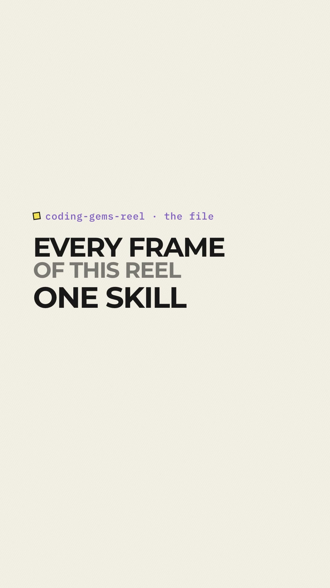
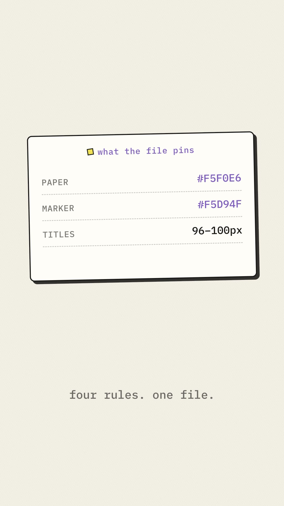
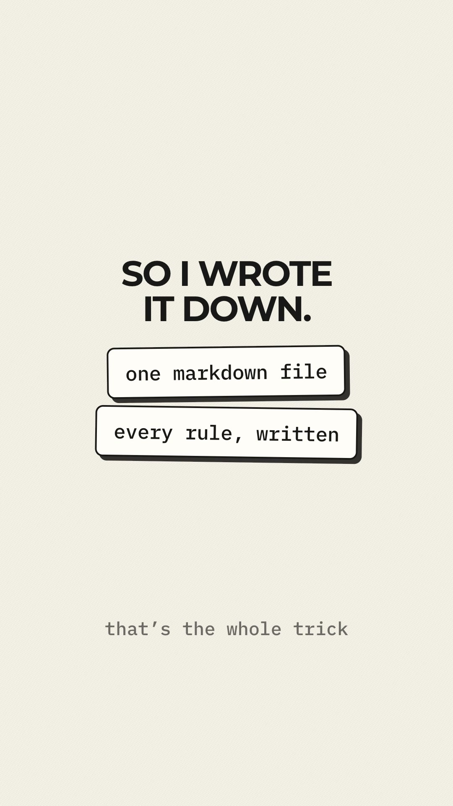

# ai-shorts-reels-video-skills

A collection of AI short-form / reels video skills. Currently includes the **coding-gems-reel** skill.

## coding-gems-reel

A HyperFrames skill for creating vertical (1080×1920, 30 fps) tech reels with a warm paper, yellow-highlight coding aesthetic. Use it for repo discoveries, Git vs GitHub explanations, and practical AI/developer tools.

- Skill file: [`skills/coding-gems-reel/SKILL.md`](skills/coding-gems-reel/SKILL.md)
- Reference notes: [`skills/coding-gems-reel/references/source-notes.md`](skills/coding-gems-reel/references/source-notes.md)

### Install

```bash
cp -r skills/coding-gems-reel ~/.agents/skills/
```

### Promo reel (made with this skill)

Screenshots from `hyperframes/videos/coding-gems-reel-promo`:






